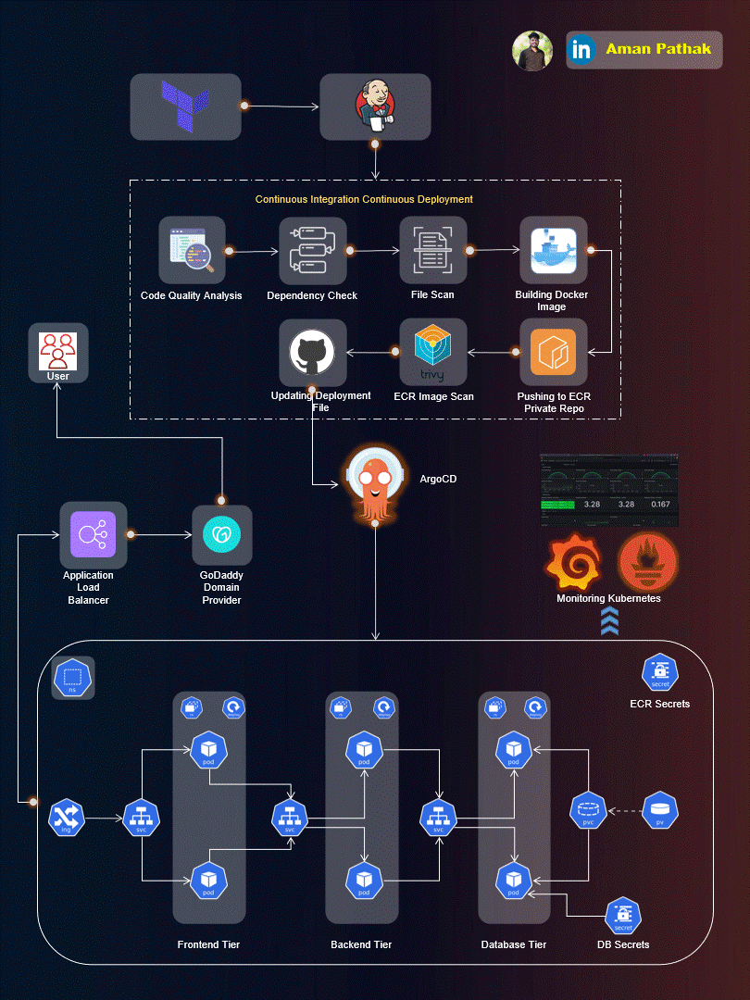

# AWS EKS three-tier platform

Portfolio lab maintained in [bckish/aws-eks-three-tier-platform](https://github.com/bckish/aws-eks-three-tier-platform). The implementation is derived from upstream work; this repository's documentation and validation changes do not imply an independently verified cloud deployment.

React frontend, Node/Express API and MongoDB with Jenkins-based image delivery, Kubernetes manifests, and a Terraform-defined Jenkins host.



## Repository map

- [Application-Code](Application-Code/): frontend and backend.
- [Jenkins-Pipeline-Code](Jenkins-Pipeline-Code/): separate frontend and backend pipeline examples.
- [Jenkins-Server-TF](Jenkins-Server-TF/): AWS infrastructure for the Jenkins server.
- [Kubernetes-Manifests-file](Kubernetes-Manifests-file/): application, database and ingress manifests.

## Reproduce and validate

```bash
git clone https://github.com/bckish/aws-eks-three-tier-platform.git
cd aws-eks-three-tier-platform
node --check Application-Code/backend/index.js
terraform -chdir=Jenkins-Server-TF init -backend=false
terraform -chdir=Jenkins-Server-TF validate
```

No AWS credentials are needed for syntax validation; provider downloads require internet access. For actual deployment, configure your own backend, account, ECR repositories, images, credentials, Kubernetes cluster and ingress domain. Review the Jenkins pipeline, including its publishing and manifest-update stages, before running it. Do not reuse upstream infrastructure or secrets. Cloud provisioning incurs cost and requires explicit approval.

The backend exposes /healthz, /ready and /started. Automated application tests and reproducible npm lockfiles are still gaps. The original [walkthrough](https://amanpathakdevops.medium.com/advanced-end-to-end-devsecops-kubernetes-three-tier-project-using-aws-eks-argocd-prometheus-fbbfdb956d1a) explains the intended full deployment.

## Attribution and license

Original implementation by Aman Pathak. See [UPSTREAM.md](UPSTREAM.md) for the source repository and [LICENSE](LICENSE) (Apache-2.0). The upstream license and copyright notices are unchanged.
